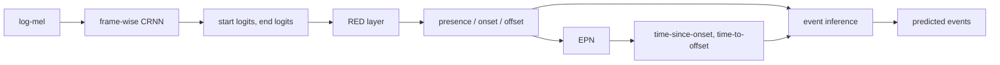
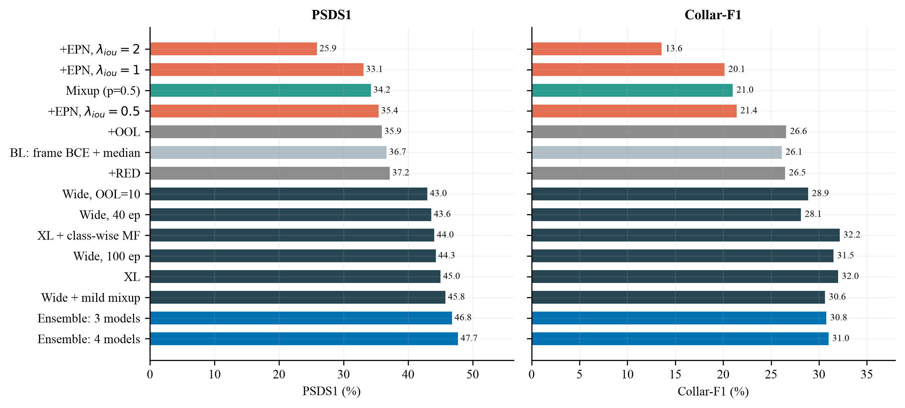
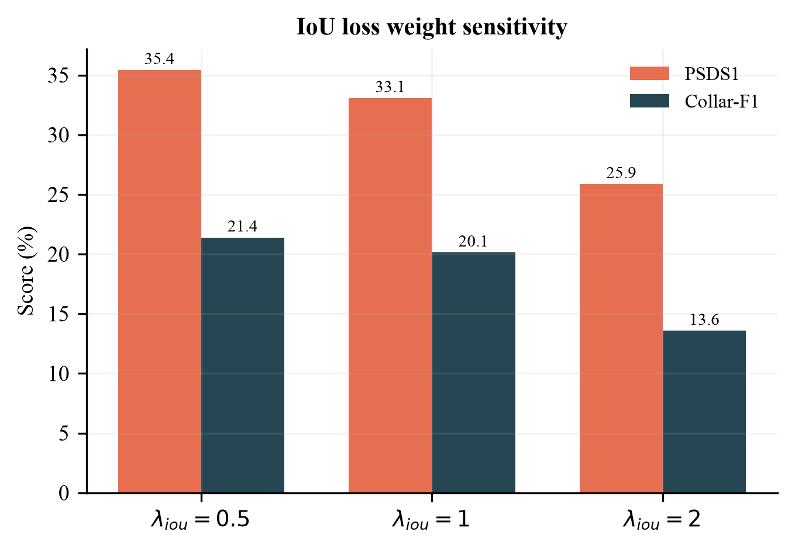
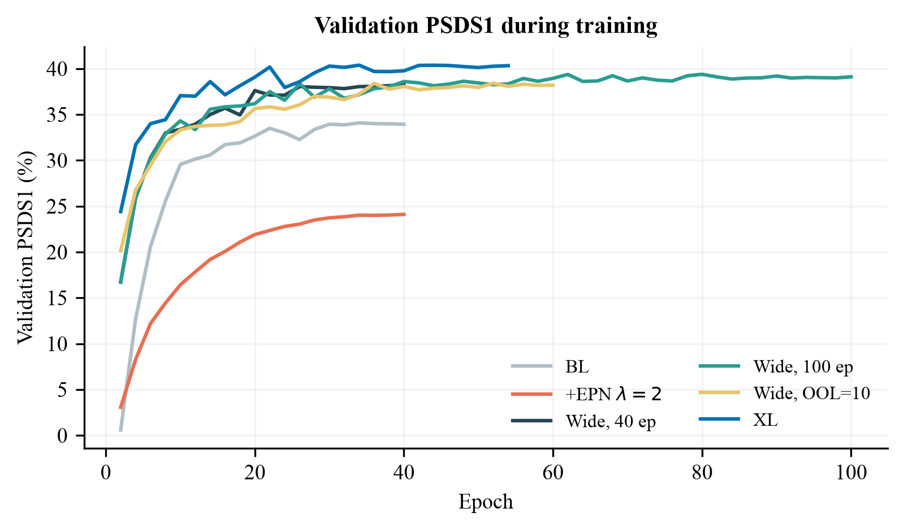

# Technical Report: Sound Event Detection with Boundary-Aware Optimization and Inference

**Le Duc Minh** · `minh.leduc.0210@gmail.com`

This report explains the paper **“Sound Event Detection with Boundary-Aware
Optimization and Inference”** (Schmid et al., arXiv:2601.04178) and the
reproduction in this repository. It is written so that a reader who knows basic
deep learning but not sound event detection can follow the method end to end.

Companion material:

- Paper: <https://arxiv.org/abs/2601.04178>
- Reproduction results: [`docs/reports/2026-11-24/urbansed-crnn/report.md`](../reports/2026-11-24/urbansed-crnn/report.md)
- Code: `src/modules/red.py`, `src/modules/epn.py`, `src/modules/loss.py`,
  `src/modules/postprocess.py`, `src/modules/metrics.py`

---

## 1. The problem: sound event detection

Sound event detection (SED) takes an audio clip and returns a set of events

$$
\mathcal{E} = \{(c_j,\; t^{\mathrm{start}}_j,\; t^{\mathrm{end}}_j)\},
$$

where \(c_j\) is the event class and the two timestamps are its boundaries.

There are two common ways to build an SED system.

**Event-based systems** directly predict a set of events. They can model
boundaries explicitly, but they need complex training objectives such as
Hungarian matching between predictions and ground truth.

**Frame-wise systems** predict, for every class \(c\) and frame \(t\), a
probability that the event is active:

$$
\hat p^{\mathrm{pres}}_{c,t} = P(e_{c,t}=1).
$$

Frame-wise models dominate current benchmarks. They train well with
multiple-instance learning and simple architectures such as a convolutional
recurrent neural network (CRNN), and they work with weakly labelled data.

Their weakness is the step from frame probabilities to events. The standard
recipe is:

1. smooth the probability curve, usually with a median filter;
2. threshold it;
3. group consecutive active frames into events.

Both the filter length and the threshold are hyperparameters tuned on a
validation set after training. This post-processing is non-differentiable and
can throw away information the model learned. The paper’s goal is to remove
that separate tuning step by learning event boundaries and event proposals
inside the model.

---

## 2. Overview of the proposed method

The method keeps a standard frame-wise acoustic model but changes what the
model predicts and how events are extracted.

Three components are added:

1. **RED (Recurrent Event Detection)** — turns conditional start/end
   probabilities into presence, onset and offset probabilities.
2. **OOL (Onset-Offset Loss)** — focal losses on the sparse onset/offset
   labels.
3. **EPN (Event Proposal Network)** — predicts a time interval around each
   frame, trained with a duration-weighted IoU loss, and replaces median
   filtering with a proposal-selection algorithm.

The acoustic model only has to output two logits per class per frame instead of
one: a start logit and an end logit.

---

## 3. RED: Recurrent Event Detection

### 3.1 Notation

For one class, let

- \(e_t\in\{0,1\}\) be the event-presence random variable at frame \(t\);
- \(s_t = P(e_t=1\mid e_{t-1}=0)\) be the conditional **start** probability;
- \(z_t = P(e_t=0\mid e_{t-1}=1)\) be the conditional **end** probability;
- \(p_t = P(e_t=1)\) be the **presence** probability.

The acoustic model produces start and end logits. Applying a sigmoid gives
\(s_t\) and \(z_t\).

### 3.2 The recurrence

Assume \(p_{-1}=0\). Presence at frame \(t\) can come from two cases:

- an event starts at \(t\): probability \(s_t\), and the previous frame was
  inactive with probability \(1-p_{t-1}\);
- an event was already active and does not end at \(t\): probability
  \(1-z_t\), and the previous frame was active with probability \(p_{t-1}\).

Therefore

$$
\boxed{
p_t = s_t(1-p_{t-1}) + (1-z_t)p_{t-1}
}
$$

The onset probability is the probability that an event starts exactly at
\(t\):

$$
\mathrm{onset}_t = s_t(1-p_{t-1}).
$$

The offset probability is the probability that an event ends exactly at
\(t\):

$$
\mathrm{offset}_t = z_t p_{t-1}.
$$

These three quantities satisfy a useful identity: presence rises at onsets and
falls at offsets, while remaining smooth elsewhere.

### 3.3 Why it is cheap

Rewrite the recurrence as an affine scan:

$$
p_t = a_t p_{t-1} + b_t,\qquad
a_t = 1-s_t-z_t,\qquad b_t=s_t.
$$

An affine recurrence can be composed associatively:

$$
(a_1,b_1)\circ(a_2,b_2)
=
(a_2a_1,\; a_2b_1+b_2).
$$

This lets us compute all \(p_t\) with a parallel prefix scan in
\(O(\log T)\) sequential steps instead of \(T\) Python iterations. The
implementation in `src/modules/red.py` uses a Hillis–Steele scan. A sequential
reference implementation is kept for unit tests.

RED has **no learnable parameters**. It is a differentiable probabilistic
layer placed on top of any frame-wise model.

### 3.4 Why this helps

The acoustic model no longer has to learn a single presence curve directly.
It learns two simpler conditional “switch” signals: when an event starts and
when it ends. Presence is then derived deterministically. The onset and offset
outputs are temporally localised peaks, which are exactly the quantities the
boundary losses can supervise.

---

## 4. OOL: Onset–Offset Loss

The ground-truth onset and offset labels are derived from the annotations:

- \(y^{\mathrm{on}}_{c,t}=1\) on the first frame of each event;
- \(y^{\mathrm{off}}_{c,t}=1\) on the first frame after each event;
- all other frames are 0.

These labels are extremely sparse: a 10-second clip has at most a handful of
boundary frames out of 500. Plain binary cross-entropy would be dominated by
the negative frames. The paper uses a focal loss with focusing parameter
\(\alpha=2\):

$$
\mathcal{L}_{\mathrm{on/off}}
=
-\frac{1}{CT}
\sum_{c=1}^{C}\sum_{t=1}^{T}
\begin{cases}
(1-\hat p_{c,t})^{\alpha}\log \hat p_{c,t}, & y_{c,t}=1,\\[4pt]
\hat p_{c,t}^{\alpha}\log(1-\hat p_{c,t}), & y_{c,t}=0.
\end{cases}
$$

The implementation computes onset and offset separately:

$$
\mathcal{L}_{\mathrm{ool}}
=
\mathcal{L}_{\mathrm{on}}+\mathcal{L}_{\mathrm{off}}.
$$

For a positive boundary frame with a low predicted probability, the factor
\((1-\hat p)^2\) is close to 1 and the loss is large. For an easy negative
frame with a low probability, \(\hat p^2\) is tiny and the loss is suppressed.
This focuses learning on the rare, hard boundary frames.

Because RED couples presence, onset and offset, supervising onset/offset also
shapes the presence curve.

---

## 5. EPN: Event Proposal Network

### 5.1 Duration prediction

EPN takes the three RED outputs per class and frame,

$$
[\hat p^{\mathrm{pres}}_{c,t},\;
 \hat p^{\mathrm{on}}_{c,t},\;
 \hat p^{\mathrm{off}}_{c,t}],
$$

and predicts two non-negative durations:

- \(\hat d^{\mathrm{on}}_{c,t}\): time since the event onset;
- \(\hat d^{\mathrm{off}}_{c,t}\): time until the event offset.

The prediction is a bidirectional GRU followed by a linear layer and a Softplus
activation:

$$
\hat d^{\mathrm{on}}_{c,t}
=
\mathrm{Softplus}(h^{\mathrm{on}}_{c,t}),\qquad
\hat d^{\mathrm{off}}_{c,t}
=
\mathrm{Softplus}(h^{\mathrm{off}}_{c,t}).
$$

The interval proposal for frame \(t\) is

$$
\hat r_{c,t}
=
[t-\hat d^{\mathrm{on}}_{c,t},\;
 t+\hat d^{\mathrm{off}}_{c,t}].
$$

The paper has two variants:

- **per-class GRUs**: one GRU per class, input \([0,1]^{3\times T}\);
- **single GRU**: one GRU over all classes, input \([0,1]^{3C\times T}\).

The per-class variant is used for AS-Strong-10. The single-GRU variant is used
when there are many classes. This repository implements both.

### 5.2 IoU loss

For a frame \(t\) inside an event, the ground-truth interval is

$$
r_{c,t}
=
[t-d^{\mathrm{on}}_{c,t},\;
 t+d^{\mathrm{off}}_{c,t}].
$$

Both \(r_{c,t}\) and \(\hat r_{c,t}\) contain \(t\), so their intersection and
union have a closed form:

$$
\mathrm{IoU}_{c,t}
=
\frac{
\min(d^{\mathrm{on}}_{c,t},\hat d^{\mathrm{on}}_{c,t})
+
\min(d^{\mathrm{off}}_{c,t},\hat d^{\mathrm{off}}_{c,t})
}{
\max(d^{\mathrm{on}}_{c,t},\hat d^{\mathrm{on}}_{c,t})
+
\max(d^{\mathrm{off}}_{c,t},\hat d^{\mathrm{off}}_{c,t})
}.
$$

The loss is evaluated only on active frames and weighted by the ground-truth
event duration:

$$
\mathcal{L}_{\mathrm{iou}}
=
\frac{1}{\sum_{c,t} y^{\mathrm{pres}}_{c,t}}
\sum_{c,t}
y^{\mathrm{pres}}_{c,t}
\left(1-\mathrm{IoU}_{c,t}\right)
\left(d^{\mathrm{on}}_{c,t}+d^{\mathrm{off}}_{c,t}\right).
$$

The duration weight makes short and long events contribute more equally per
event. Without it, long events would dominate the sum simply because they have
more active frames.

---

## 6. Event inference

The paper replaces thresholding + median filtering with Algorithm 1.

Inputs:

- presence probabilities \(\hat p^{\mathrm{pres}}_{c,t}\);
- proposals \(\hat r_{c,t}\);
- \(k\): maximum events per class (default 15);
- \(m\): number of most active classes (default all).

For each selected class:

1. sort frames by presence;
2. take the highest-scoring unprocessed proposal;
3. compute its event score \(\sigma\) as the mean presence over the proposal;
4. emit \((c,\;t-\hat d^{\mathrm{on}},\;t+\hat d^{\mathrm{off}},\;\sigma)\);
5. suppress every proposal that overlaps the chosen interval;
6. repeat until \(k\) events or no proposals remain.

This is a non-maximum-suppression-like procedure. It is not differentiable; it
only converts the learned proposals into a final event set.

The baseline for comparison is the usual frame-wise post-processing:

$$
\tilde p_t
=
\operatorname{median}
\left(
p_{t-\lfloor L/2\rfloor},\ldots,p_{t+\lfloor L/2\rfloor}
\right),
$$

followed by a threshold \(\tau\) and grouping of consecutive active frames.

---

## 7. Combined training objective

The full loss is

$$
\boxed{
\mathcal{L}
=
\mathcal{L}_{\mathrm{pres}}
+
\lambda_{\mathrm{ool}}
\left(
\mathcal{L}_{\mathrm{on}}+\mathcal{L}_{\mathrm{off}}
\right)
+
\lambda_{\mathrm{iou}}\mathcal{L}_{\mathrm{iou}}
}
$$

where

$$
\mathcal{L}_{\mathrm{pres}}
=
-\frac{1}{BCT}
\sum_{b,c,t}
\left[
y_{b,c,t}\log\hat p_{b,c,t}
+
(1-y_{b,c,t})\log(1-\hat p_{b,c,t})
\right].
$$

The paper uses \(\lambda_{\mathrm{ool}}=100\), focal \(\alpha=2\), and tunes
\(\lambda_{\mathrm{iou}}\in\{0.5,1,2,4\}\). The paper’s ablation is:

| Configuration | Presence BCE | OOL | IoU |
|---|---:|---:|---:|
| BL | frame logits | — | — |
| +RED | RED presence | — | — |
| +OOL | RED presence | ✓ | — |
| +EPN | RED presence | ✓ | ✓ |

---

## 8. Evaluation metrics

### 8.1 PSDS1

PSDS1 is threshold-independent. For each class \(c\) and operating point
(score threshold), define

$$
r_c=\frac{TP_c}{TP_c+FN_c},\qquad
f_c=\frac{FP_c\cdot 3600}{T_{\mathrm{ds}}},
$$

where \(T_{\mathrm{ds}}\) is the evaluation-set duration in seconds and
\(f_c\) is false positives per hour.

A prediction matches a ground-truth event of the same class when their temporal
IoU is at least 0.5. The per-class curves are averaged:

$$
\bar r(f)=\frac{1}{C}\sum_{c=1}^{C}r_c(f).
$$

PSDS1 is the normalised area under this curve:

$$
\mathrm{PSDS1}
=
\frac{1}{e_{\max}}
\int_0^{e_{\max}}\bar r(f)\,df,
$$

with \(e_{\max}=100\) false positives per hour. The paper reports PSDS1 without
the inter-class variance penalty.

### 8.2 PSDS2

PSDS2 is the DCASE scenario-2 metric. It focuses more on class recognition than
on exact boundaries:

- DTC = 0.1, GTC = 0.1, CTTC = 0.3;
- cross-trigger weight \(\alpha_{\mathrm{CT}}=0.5\);
- inter-class variance penalty \(\alpha_{\mathrm{ST}}=1\).

The effective false-positive rate adds cross-triggers:

$$
e_c
=
f_c
+
\alpha_{\mathrm{CT}}
\frac{1}{C-1}
\sum_{k\ne c}
\frac{CT_{c,k}\cdot 3600}{T_k},
$$

where \(CT_{c,k}\) is the number of class-\(c\) detections that cross-trigger
class \(k\), and \(T_k\) is the total activity duration of class \(k\).

### 8.3 Collar-F1

Collar-F1 matches an event when

$$
|\hat t_{\mathrm{on}}-t_{\mathrm{on}}|\le 0.2,\qquad
|\hat t_{\mathrm{off}}-t_{\mathrm{off}}|
\le
\max(0.2,\;0.2\cdot d),
$$

where \(d\) is the ground-truth duration. With matched counts:

$$
P=\frac{TP}{TP+FP},\qquad
R=\frac{TP}{TP+FN},\qquad
F_1=\frac{2PR}{P+R}.
$$

Collar-F1 is threshold-dependent; PSDS1/PSDS2 are not.

---

## 9. Reproduction setup

| Item | Choice |
|---|---|
| Dataset | URBAN-SED v2.0.0 |
| Clips | 6,000 train / 2,000 validate / 2,000 test |
| Classes | 10 |
| Audio | mono, resampled to 16 kHz |
| Features | 64-band log-mel, 25 ms window, 20 ms hop, 500 frames |
| Backbone | 4 conv blocks + 2-layer BiGRU |
| Default EPN | single-GRU variant |
| Optimizer | AdamW |
| Epochs | 40 |
| Batch size | 128 (64 for wide model) |
| LR | 1e-3 (8e-4 wide), cosine, 100 warmup steps |
| Augmentation | none by default; mixup + SpecAugment in one extension |
| Hardware | RTX PRO 4000 Blackwell, 24 GB |

---|---|
| log-mel, targets, dataset | `src/data.py` |
| CRNN, RED wrapper, EPN wrapper | `src/modules/model.py` |
| RED scan | `src/modules/red.py` |
| EPN duration heads | `src/modules/epn.py` |
| losses | `src/modules/loss.py` |
| median / Algorithm 1 | `src/modules/postprocess.py` |
| PSDS1 / PSDS2 / collar-F1 | `src/modules/metrics.py` |
| training / evaluation | `src/pipelines/train.py`, `src/pipelines/eval.py` |

---

## 10. Reproduction results

Test split; epochs vary (40/60/100):

| Run | PSDS1@0.5 | PSDS2 | collar-F1 | frame-F1 |
|---|---:|---:|---:|---:|
| BL: frame BCE + median | 36.67 | 73.13 | 26.11 | 59.14 |
| +RED | 37.16 | 71.43 | 26.47 | 59.01 |
| +OOL | 35.93 | 71.26 | 26.57 | 57.85 |
| +EPN, λ_iou=2 | 25.87 | 51.41 | 13.57 | 35.95 |
| +EPN, λ_iou=1.0 | 33.08 | 66.13 | 20.13 | 50.33 |
| +EPN, λ_iou=0.5 | 35.42 | 69.83 | 21.39 | 55.17 |
| Wide model, 40 ep | 43.58 | 73.73 | 28.12 | 62.30 |
| Wide model, 100 ep | 44.28 | 70.77 | 31.50 | 63.16 |
| Wide, OOL=10, 60 ep | 42.97 | 72.62 | 28.87 | 61.47 |
| XL model, 60 ep | 45.02 | 72.38 | 31.98 | 63.56 |
| Wide + mild mixup, 60 ep | 45.77 | 76.11 | 30.63 | 64.06 |
| XL + class-wise median | 44.05 | 73.28 | 32.16 | 63.56 |
| Ensemble: 3 models | 46.81 | 75.17 | 30.77 | — |
| **Ensemble: 4 models** | **47.73** | **76.74** | **30.99** | — |

The central result is negative: at the paper's default λ_iou=2 the full method
scores 25.87 PSDS1 against the 36.67 baseline, and at λ_iou=0.5 it reaches 35.42
but still does not beat the baseline. A tuned median filter and EPN inference
are close on the same model. Capacity, longer training, mild mixup and
ensembling provide the gains shown below.

Main observations:

- RED alone matches the baseline, so the recurrence itself is not the problem.
- OOL at λ=100 does not help on URBAN-SED.
- The IoU weight is critical: λ=2 collapses performance, λ=0.5 recovers most of
  it. The paper tunes this weight per backbone.
- Capacity, longer training and mild augmentation help. The wide model reaches
  43.58 PSDS1, the XL model 45.02, and wide + mild mixup 45.77.
- A four-model probability ensemble reaches **47.73 PSDS1 / 76.74 PSDS2**, the
  best result in this reproduction.
- Synthetic max-mixing at p=0.5 is too aggressive and hurts.

Full details: [`docs/reports/2026-11-24/urbansed-crnn/report.md`](../reports/2026-11-24/urbansed-crnn/report.md).

---

## 11. Extensions for improving PSDS1

The reproduction above is a baseline, not a tuned system. The next experiments
are chosen from standard SED practice:

1. **Longer training** — 100 epochs instead of 40, with early stopping.
2. **Lower OOL weight** — λ_ool=10 instead of 100.
3. **Class-wise median-filter tuning** — the paper and DCASE systems tune filter
   length per class, not one global value.
4. **Checkpoint SWA / ensemble** — average weights or probabilities from
   multiple checkpoints. Ensembles are a reliable PSDS1 gain in DCASE systems.
5. **Mild augmentation** — lower mixup probability and weaker SpecAugment.
6. **Wider/deeper model** — another capacity step beyond the current wide model.
7. **Larger post-processing search** — per-class thresholds and minimum
   durations.

Results of these experiments will be added to this report and to
`docs/reports/`.

---

## 12. Limitations

- URBAN-SED is not AudioSet Strong; absolute numbers are not comparable to the
  paper.
- The paper trains up to 100 epochs and tunes the learning rate per backbone;
  this reproduction mostly uses 40 epochs and one seed.
- The default EPN is the single-GRU variant because per-class GRUs are slow.
- SEBB and HSM3 baselines are not implemented.
- PSDS1 here uses IoU-0.5 matching as stated in the paper; the official
  `psds_eval` DTC/GTC criterion is slightly different.
- Collar-F1 is reported at a configured threshold; it is not exhaustively
  tuned per class.

---

## 13. Glossary

| Term | Meaning |
|---|---|
| SED | Sound event detection: class + start + end. |
| Frame-wise model | Predicts a probability per class per frame. |
| RED | Recurrent Event Detection: parameter-free boundary-to-presence layer. |
| OOL | Onset–Offset Loss: focal loss on boundary frames. |
| EPN | Event Proposal Network: predicts onset/offset durations. |
| IoU | Intersection over union of two time intervals. |
| PSDS1 | Threshold-independent localisation-focused SED score. |
| PSDS2 | Threshold-independent classification-focused SED score. |
| Collar-F1 | Event F1 with a tolerance around boundaries. |
| MF | Median filtering. |
| SEBB | Sound Event Bounding Boxes, a strong post-processing baseline. |

## 12. Conclusion

RED provides a clean probabilistic bridge from boundary conditionals to
presence, onset and offset probabilities. EPN turns those probabilities into
duration proposals, and the inference step converts them into events without a
median-filter grid. On URBAN-SED, the boundary losses did not beat a strong
frame-wise baseline at the weights tested. Capacity, longer training, mild
augmentation and probability ensembling produced the gains. The best
configuration is the four-model ensemble at 47.73 PSDS1 and 76.74 PSDS2. These
results describe URBAN-SED and should not be read as evidence about AudioSet
Strong.

## References

1. F. Schmid et al., “Sound Event Detection with Boundary-Aware Optimization
   and Inference,” arXiv:2601.04178, 2026.
2. J. Salamon et al., “URBAN-SED,” Zenodo, 2017.
   (The compiled PDF contains the full 31-entry bibliography.)
3. J. Ebbers et al., “Threshold Independent Evaluation of Sound Event Detection
   Scores,” ICASSP 2022.
4. Ç. Bilen et al., “A Framework for the Robust Evaluation of Sound Event
   Detection,” ICASSP 2020.
5. F. A. Heinsen, “Efficient Parallelization of an Ubiquitous Sequential
   Computation,” arXiv:2311.06281, 2023.
